<p align="center">
  
</p>

<p align="center">
  
</p>

<p align="center">
  
  
  
  
</p>

## `$ whoami`

<p align="center">
  
</p>

```yaml
name: hidra0x
role: iOS kernel research
target: iPhone XR · A12 / T8020 · iOS 18.7.2
focus: AppleJPEGDriver CVE-2026-20687 → controlled free → double-free/write
strategy: data-only kernel control · no text patching · no fake PAC pointers
status: S0–S3 done · S4 in progress · no public build
```

I break things on a spare iPhone, read XNU at night, and write down every
panic. The goal is not another crash — it is **kernel control** through data,
not through a forged function pointer.

## `$ ls ~/projects`

<table>
  <tr>
    <td width="50%" valign="top">
      <h3><a href="https://github.com/hidra0x/hidra">HIDRA</a></h3>
      <p>A12 / iOS 18.7.2 jailbreak research. Kernel entry via AppleJPEGDriver, then a data-only path to kernel r/w.</p>
      <p><code>S0–S3 done</code> · <code>S4 in progress</code></p>
    </td>
    <td width="50%" valign="top">
      <h3><a href="https://github.com/hidra0x/hidgate-poc/tree/main/PoC/applejpeg">MOON Probe</a></h3>
      <p>Open-source AppleJPEGDriver PoC: userclient, 0x58 ABI, deferred UAF, runnable IPA.</p>
      <p><code>v0.1</code> · <code>unsigned IPA</code></p>
    </td>
  </tr>
  <tr>
    <td width="50%" valign="top">
      <h3><a href="https://github.com/hidra0x/hidgate-poc">hidgate-poc</a></h3>
      <p>Kernel UAF research on 18.7.2/A12: IOHID crash-only, AppleJPEG controlled free, panic analysis, test matrix.</p>
      <p><code>research</code> · <code>18.7.2</code></p>
    </td>
    <td width="50%" valign="top">
      <h3><a href="https://github.com/hidra0x/aurora-tv">Aurora TV</a></h3>
      <p>Lightweight Android TV launcher for Telefunken / Android 5–14. No ads, no trackers, no Google Play Services.</p>
      <p><code>v1.4.0</code> · <code>Kotlin</code></p>
    </td>
  </tr>
</table>

## `$ cat /now`

- **RE:** `AppleJPEGDriver 7.6.9`, `IOUserClient2022`, queue / power paths.
- **Hunting:** a double-free or write primitive from the stale `JpegRequest` queue node (S4).
- **Strategy:** data-only — `proc`, `ucred`, `csflags`, AMFI/MACF; no kernel text patching, no page tables unless required.
- **Next:** KASLR leak after a write primitive; then PAC/PPL/KTRR-safe bootstrap.

## `$ ./stack`

<p align="center">
  
</p>

<p align="center">
  
  
  
  
</p>

## `$ ./metrics`

<p align="center">
  
</p>

<p align="center">
  
  
  
</p>

## `$ ./snake`

<p align="center">
  
</p>

## `$ contact`

<p align="center">
  <a href="https://github.com/hidra0x"></a>
  <a href="https://github.com/hidra0x/hidra"></a>
  <a href="https://github.com/hidra0x/hidgate-poc/releases/tag/moon-poc-v0.1"></a>
</p>

<p align="center">
  <i>«Паника — это не конец. Это доказательство, что мы уже в ядре.»</i>
</p>

<p align="center">
  <b>CRASH → CONTROL → JAILBREAK</b>
</p>
